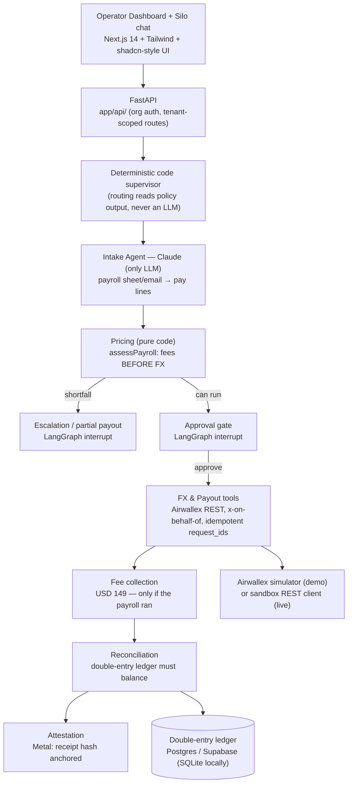
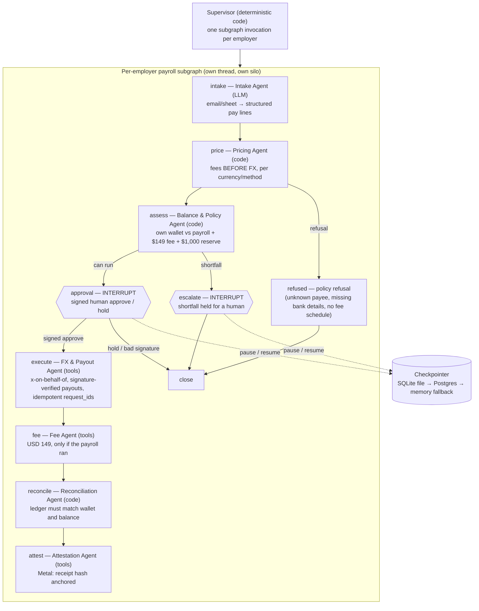

# PaySilo — Multi-Employer Payroll Executor

**Team STATIC · Airwallex Agentic Banking Hackathon · Starter Kit 06 (Multi-Tenant Platforms)**

> One platform. Many employers. Zero cross-contamination of funds.
> Payroll that respects whose money it is.

## The story

Vertex Payroll Services runs payroll for other small companies. Acme
Manufacturing GmbH loads USD 20,000 and must pay Lena Fischer EUR 3,400 and
Tomas Rivera EUR 2,600. Borealis Labs AB loads only USD 5,000 but owes
Ingrid Solberg EUR 6,000 — plus SWIFT fees, priced *before* conversion, the
USD 149 run fee, and a USD 1,000 reserve floor, it needs about USD 7,642.88.
Borealis is **short by USD 2,642.88**.

The platform total looks rich — and mid-run, Cobalt Retail LLC receives a
fresh USD 10,000 deposit. A tired accountant, or a badly built AI, quietly
covers Borealis from Acme or Cobalt. Nobody notices that day. Everybody
notices one day.

**PaySilo's golden rule is written in code, not in a prompt:** every
employer's money lives in its own sealed silo (its own Airwallex connected
account, wallet, and ledger namespace; every API call carries
`x-on-behalf-of`), and the agent can never move money between silos. When
Borealis comes up short, only Borealis's payroll is held and escalated to a
human. Cobalt's deposit changes Cobalt's wallet — not Borealis's.

When an employer can afford *part* of its batch, PaySilo follows the Kit 6
rule — **"pay what its own balance supports, then escalate"** — paying the
**smallest lines first** while still covering the run fee and keeping the
reserve. Delta Studios BV (USD 5,000) owes Noor van Dijk EUR 2,200 and
Pieter Jansen EUR 3,600: Noor is paid, Pieter is held and escalated, and the
run ends **PARTIALLY_PAID** with USD 2,461.12 left in Delta's own wallet.

Once Delta tops up its own wallet, **Pay held lines** pays Pieter in a linked
continuation run: Noor is never paid twice and the USD 149 run fee is not
charged a second time (see "Held lines and continuation runs").

> **The model reads, the code decides, the API moves the money.**
> The only LLM use in PaySilo is intake (reading messy payroll sheets) and
> plain-language explanation. Pricing, fees, affordability, tenant
> isolation, idempotency, and routing are deterministic, tested code.

## Architecture



Run lifecycle per employer:
`PRICED → RESERVED → APPROVED → SENT → SETTLED`, or

- `PARTIALLY_PAID` — Kit 6 partial payout: the lines its own wallet supports
  were paid (smallest first), the rest are `HELD` and escalated;
- `HELD_SHORTFALL` — not even the smallest line fits; nothing is paid and
  nothing is borrowed;
- `HELD_BY_HUMAN` / `APPROVAL_REJECTED` / `REFUSED` — no money moved;
- `SENT_FEE_FAILED` / `SENT_UNRECONCILED` / `ATTEST_PENDING` — money already
  moved but a later step needs follow-up; the state is persisted, never lost.

## The LangGraph agent — architecture in depth

PaySilo's agent is a **LangGraph supervisor running one independent
subgraph per employer**. The supervisor itself is deterministic code —
it never asks a model where a run should go. Each employer's run gets
its own LangGraph thread (`thread_id` = the run id), its own state,
its own connected account and its own ledger namespace, so checkpoints,
interrupts and money are per-employer by construction. One employer's
failure is caught, recorded, and never contaminates the rest of the
batch.



### What each node does

| Node | Kind | Job |
|---|---|---|
| `intake` | **LLM** | Reads payroll sheets and emails into structured pay lines (Claude). Names are then matched against *this employer's own* contractor directory — a name that is not in the directory gets no bank details and cannot be paid. |
| `price` | code | Prices salaries plus payout fees per currency and method (SWIFT EUR 12.85 per payout) *before* any FX conversion. Unknown currency rate or fee schedule is a refusal, never a guess. |
| `assess` | code | Checks only this employer's wallet against payroll + the USD 149 run fee + the USD 1,000 reserve floor. If the full batch doesn't fit, pays the smallest lines it can (Kit 6 partial payout) and escalates the rest; routes to approval, escalation, or refusal. |
| `approval` | human interrupt | Pauses the run. It resumes only with a TAP-style signature (our internal approval-integrity mechanism) over the exact run, employer, amounts, the lines to pay and (for a partial payout) the held lines; a missing, tampered or replayed signature rejects the approval and moves no money. |
| `escalate` | human interrupt | Holds a short payroll and surfaces the exact shortfall and the employer's options. A short payroll can only be held — there is no "approve anyway" path. |
| `execute` | tools | Re-checks affordability against fresh balances, then converts and pays on the employer's behalf only (`x-on-behalf-of`), each payout signed and verified against the signed approval immediately before the transfer, every call carrying a deterministic idempotent `request_id`. |
| `fee` | tools | Collects the USD 149 platform run fee — only from payrolls that actually ran. Held or refused runs are charged nothing. |
| `reconcile` | code | Proves the double-entry ledger matches the wallet in every currency and the books balance; a mismatch refuses to close the run. |
| `attest` | tools | Anchors a hash of the reconciliation receipt on the settlement chain (Metal). Hashes only — no raw financial data on chain. |

### Why only Intake uses an LLM

The model *reads*; the code *decides*; the API *moves the money*.
Reading messy human input (an email, a pasted sheet) is the one job
where a language model is genuinely better than rules — and its output
is the least trusted data in the system: extracted lines are matched
against the employer's own contractor directory, priced by
deterministic policy, checked for affordability, and still pause for a
signed human approval before a single unit moves. Everything
downstream of intake — fees, affordability, routing, tenant isolation,
idempotency — is arithmetic and policy, where "usually right" is not
acceptable and deterministic code is testable to the cent. An LLM
failure in intake is therefore bounded: at worst it produces a run a
human declines, never a payment.

Silo, the chat assistant, follows the same rule: its tools are scoped
to the signed-in organization (context comes from the session, never
from model input), and its tool set deliberately contains **no approve
tool and no transfer tool** — chat can start a run and surface its
pending approval, and that is all.

### The checkpointer story

A run paused at an interrupt must survive a restart, so graph state is
checkpointed per thread. `app/agents/checkpoint.py` picks the
checkpointer in order:

1. **File-backed SQLite** when `CHECKPOINT_PATH` is set — used by tests
   and single-node deployments; a new graph instance built on the same
   file resumes a paused run exactly where it stopped (proven by the
   restart tests in the suite).
2. **Postgres** (`PostgresSaver`) when `DATABASE_URL` points at
   Postgres — the production wiring (Supabase), through the same
   LangGraph checkpointer interface.
3. **MemorySaver** as a last-resort fallback — paused runs do *not*
   survive a restart in this mode, and the runtime says so honestly:
   such runs are reported as not resumable and a new run must be
   started.

Failed runs resume from their checkpoint too: progress markers
(`fx_done`, `completed_payouts`) plus deterministic `request_id`s mean
a retry skips work that already completed and can never pay a
contractor twice.

### Held lines and continuation runs

A run that ends `PARTIALLY_PAID` (or `HELD_SHORTFALL`) keeps its unpaid lines as
`HELD` pay lines. After the employer tops up **its own** wallet, **Pay held
lines** (`POST /runs/{run_id}/pay-held`, owner/admin) starts a **new run** linked
to the original (`payroll_runs.parent_run_id`, `source = "continuation"`):

- It contains only the parent's `HELD` lines, with the held amounts but the
  contractors' *current* bank details. It goes through the normal pricing,
  Visa TAP-signed approval and payout path, with request ids derived from the
  new run id, so contractors already paid are never paid again.
- The USD 149 run fee is per payroll, not per click: if it was already collected
  on the parent or any run up the chain, the continuation neither prices nor
  charges it again. If nothing was collected yet (parent `HELD_SHORTFALL`), it is
  charged normally. The approval card states which applies.
- Allowed only for a `PARTIALLY_PAID` / `HELD_SHORTFALL` parent with held lines,
  an active employer, no open or money-moved continuation of that parent (a
  refused, held, rejected or shortfall continuation can be tried again; a
  `FAILED` one is retried with `/retry`), and no later payroll that already paid
  the held contractor. The one-open-run-per-employer rule still applies. A held
  contractor who was deactivated or deleted returns 422 naming them.
- A continuation that is itself `PARTIALLY_PAID` can be continued again.
- Silo chat has a matching `pay_held_lines` tool ("pay the held lines for Delta
  Studios"); like `start_payroll_run` it only starts the run, which then waits for
  a human approval.

Demo: after Delta's partial run (wallet USD 2,461.12), add USD 4,000, press
**Pay held lines** and approve: Pieter's EUR 3,600 (USD 3,901.88 with the EUR
12.85 fee) is paid, no second run fee, wallet USD 2,559.24, run `SETTLED`; the
original run stays `PARTIALLY_PAID` and links to the continuation.

### Settlement mode and payment priority

Every employer chooses what happens when its own wallet cannot cover the whole batch (plus payout fees, the
USD 149 run fee and the USD 1,000 reserve). Owners and admins set it on the employer page.

| Mode | When the wallet is short |
|---|---|
| `ALL_OR_NOTHING` (default for employers created from now on) | Nobody is paid. The run is `HELD_SHORTFALL` with funding guidance; once the wallet is funded, `Pay held lines` (or autopilot) continues it. |
| `PARTIAL` (what every employer that existed before this option keeps) | Pay what fits and hold the rest (`PARTIALLY_PAID`, the continuation flow above). Lines are walked by contractor **priority** (lower number first), ties smallest first; a line that does not fit is held and the walk goes on. |

Contractor priority (default 100) is edited in the contractor panel and only matters in `PARTIAL` mode. The risk
gate applies in both modes: a risk-held line is always just that line held; the mode decides affordability over
the remaining lines. The approval snapshot binds exactly which lines pay and which are held.

### Spend categories: Onboarding kits and Travel

Besides Silo Benefits, an employer can have an **onboarding budget** (new-joiner kits: background check, software
seats, gift card, peripherals) and a **travel budget** (trips with per-category caps for transport, lodging,
per-diem and other). Each has its own journal book (`onboarding_expense`, `travel_expense`) and can never touch
wage funds; payroll that is held locks them (wages first). A kit or trip is approved by a person as ONE snapshot
(hash over every item and the expiry). Purchases use the same two-phase Airi flow as Benefits: one mandate per
item, a human authorizes it in Airi and clicks Complete; in simulated mode items complete instantly and are
labelled SIMULATED. A kit or trip is complete only when every item is. A component above the credential's
per-transaction limit (USD 200 on the test card) is approvable but blocked with `TX_LIMIT_EXCEEDED`: never faked,
never split. Silo chat can read and *propose* kits and trips, never approve or buy.

### Workflows (what they can and cannot do)

`/dashboard/workflows` is a visual builder (React Flow) for saved node graphs that a deterministic engine runs
when an event happens (employer added, contractor joined, payroll held or settled, funds received, kit
approved/completed, trip proposed, benefit requested, or on a weekly/monthly schedule). There is no model at run
time. Actions: draft an onboarding kit, create an approval request, send an email (queued through the
**Notifications** outbox, never sent inline), create an exception, post a chat notice, create a funding reminder
(the platform funding service), prepare a payroll run (the normal run-start path: priced and left waiting for a
human) and revalidate held payroll (the same guarded path as autopilot: a parent run never gets two
continuations; if one exists the step links to it).

A workflow can **never** approve, sign, pay, purchase, verify a bank change or bypass the risk gate: no such
action exists, graphs containing one are rejected, and a `Wait for approval` gate only resumes from the real human
decision endpoints (run decision, kit decision, trip decision). Every workflow query is scoped to the caller's
organization. The **Morning brief** (`/dashboard/workflows/brief`) shows, per employer, what is needed, what the
wallet holds, the shortfall and who will be paid versus held; approving goes through the normal run decision.

**Builder (v2).** The canvas flows left to right (input on a step's left edge, output on its right; conditions have
Yes / No outputs), drag a step's right circle to the next step's left circle to connect, click a line and press
Delete to remove it. Invalid connections (trigger to trigger, a second trigger, loops, duplicates) show a short
toast that says what to do instead, and the server enforces the same rules on save. The editor fits the viewport
(palette | canvas | inspector, bottom sheets on phones). **JSON** drawer: copy, download, paste or upload; import is
validated by the server and only replaces the canvas, nothing is saved until Save. **Schedule trigger**: one
employer, monthly (day 1-31 / last day) / weekly / once, time + timezone (default Asia/Kolkata), weekend rule, and a
server-computed "next 3 runs". **Create payroll schedule** (employer page and calendar) builds *Schedule -> Prepare
payroll run -> email approvers -> Wait for approval* for one employer and enables it only after an explicit confirm;
scheduled occurrences show as read-only chips on the calendar. The schedule tick is idempotent (one run per
occurrence), catches up at most one missed occurrence within 24 hours and never fires across organisations.
**Build with Silo** asks the chat agent to draft a workflow: validated by the same rules (2 retries with the
validator's errors), saved **disabled** and flagged for a human to review; the agent cannot enable, run, approve or
delete anything. Without a model key only "monthly payroll for <employer> on day N" and the standard templates can
be drafted. See `backend/docs/workflows.md`.

### Risk rules (the risk gate, code-decided)

A new `risk` node runs before pricing. It holds (never pays) lines that trip a deterministic rule; the held
lines carry a reason code, appear in the preview before approval (`assessment.risk_held_lines`, the approval
`held_lines`), are bound into the Visa TAP-signed approval snapshot, and are saved as `HELD` pay lines with
`hold_reason`. Nobody, approver included, can approve them into a payout: they are not in `pay_lines`, and
the execute step refuses any line that is not VERIFIED as a second defence.

| Code | Rule |
| --- | --- |
| `BANK_UNVERIFIED` | `bank_verification_status != VERIFIED` (changed or newly submitted, awaiting a second person's callback check). |
| `RECENT_BANK_CHANGE_LARGE_PAYMENT` | Bank details changed in the last 7 days AND the line is above 2x the contractor's previous paid amount (same currency), or above USD 5,000 when there is no history, unless a different person verified them after the change. Fails closed if no rate is available. |

Other guards: the facts come from the database at run start (a client-supplied value is overwritten; an unknown
contractor id is held as unverified), bank details that change between preview and approval block the approval,
and **Pay held lines** is refused until the held contractors are verified (then it works as usual). Existing rows
migrate as VERIFIED, so nothing changes for existing data. The demo bank change awaiting verification is on Sam Lee
(Cobalt), not on a Delta contractor.

Emails go through the Notification outbox. Mail carrying a private link (contractor onboarding link, org
invitation) is marked sensitive: the stored/listed body is a redaction placeholder, the real text is held only
until it is delivered and is never returned by any API. Bank-change callback requests (masked account only) go
to the employer contact and the approvers. Run settled / payment failed notices are queued when the run finishes
(one per run and recipient, shared with the sweep).

### Safety rules (enforced in code, tested in the suite)

- **Tenant isolation is absolute.** Organisation and employer context
  come from the authenticated session, never from model input; every
  query and every money call is scoped to one employer's silo.
- **Money moves only on a cryptographically signed human approval.** The agent
  proposes, deterministic code decides, the API moves money. No tool —
  chat, intake, or otherwise — approves or transfers.
- **Allow-listed beneficiaries only.** A pay line must resolve to a
  contractor in the employer's own directory with bank details on file.
- **One open run per employer**, and affordability is re-checked right
  before money moves, so two runs can never both spend the same wallet.
- **Post-payout failures are persisted** (fee, reconcile, Metal) instead of
  being lost after money already moved.
- **Every money-moving step is audited** in `agent_events`, and every
  Airwallex call is persisted with its `request_id`.
- **Limits are the affordability rule itself:** a run's priced total
  (payroll + payout fees + USD 149 run fee) plus the USD 1,000 reserve
  floor must fit inside the employer's own wallet, and because balances
  are ledger-derived, cumulative same-day runs draw down the same
  wallet and hit the same ceiling.

The behaviour above is pinned by the test suite: end-to-end money
tests, scenario tests (multi-currency, partial lists, mid-run deposits,
failure + retry, restart while paused) and an adversarial suite
(injection, cross-tenant requests, inflated amounts, replayed
approvals) — see `backend/tests/` and the intake eval in
`backend/evals/`.

## Partner tools — each with one concrete job

| Partner | Job in PaySilo | Where |
|---|---|---|
| **Airwallex** | The money itself: connected accounts (create → update with EIN → submit → ACTIVE), wallets, FX, beneficiaries, SWIFT/LOCAL transfers, platform fee via `charges/create` — every employer-scoped call with `x-on-behalf-of` | `backend/app/airwallex/` |
| **Claude (Anthropic)** | Reads payroll sheets/emails into pay lines (Intake Agent) and powers the Silo chat (tools + context). Never touches arithmetic or money decisions. Chat can also run on OpenAI / Groq / Meta via `LLM_PROVIDER` | `backend/app/agents/intake.py`, `backend/app/chat/` |
| **Visa VIC (via Airi)** | The Visa commerce integration: employer-funded benefits (courses, equipment) purchased by the agent with a VIC-tokenized credential obtained through Airi (Kit 9), inside a separate benefits budget that can never touch wage funds. Runs SIMULATED against the published Airwallex test card (US$200 per transaction) unless `VIC_MODE=live` with the real `airi-cli` signed in | `backend/app/partners/vic.py`, Benefits screen |
| **TAP-style request signing** | PaySilo's *internal* approval-integrity mechanism (not a Visa product integration) — signed approvals & payout instructions: Ed25519, RFC 9421-style signatures over method/authority/path + SHA-256 content digest, nonce replay guard, expiry. Keys from `TAP_PRIVATE_KEY`, public keys at `/.well-known/tap-keys`, verification at `POST /tap/verify` | `backend/app/partners/tap*.py`, `backend/app/api/routes/tap.py` |
| **Metal** | Reconciliation receipt anchoring on Metal L2 testnet (`SettlementRegistry.sol`): hashes only, waits for the transaction receipt before claiming "anchored", hash chain continues across restarts. Offline mock chain until configured — always labelled `mock` | `backend/app/partners/metal.py`, `contracts/` |
| **AWS Bedrock AgentCore** | Deployment runtime: the same graph wrapped as an AgentCore entrypoint | `backend/app/partners/agentcore.py`, `deploy/agentcore/` |
| **LangGraph** | Agent orchestration: per-employer subgraphs, human-in-the-loop interrupts, durable checkpoints (SQLite / Postgres) | `backend/app/agents/` |
| **Supabase** | Postgres for everything persisted; RLS enabled on every table (incl. LangGraph checkpoints) so the public REST API can read nothing | `backend/app/db/` |

## Run it — demo mode (no API keys)

Needs Python 3.12 with [uv](https://docs.astral.sh/uv/) and Node 20+. Commands work in PowerShell and bash.

### Backend

```
cd backend
uv sync
uv run pytest                                              # 245 tests
uv run uvicorn app.main:app --reload --reload-dir app --port 8000
```

- `--reload-dir app` matters: without it the reloader also watches `.venv` and restarts dozens of times whenever a package changes.
- API docs at http://localhost:8000/docs, partner status at http://localhost:8000/health.
- Config is read from `.env` (repo root or `backend/`; see `.env.example`). With no `DATABASE_URL` a local SQLite file `backend/paysilo.db` is used.
- With `APP_ENV=demo` (default) the Airwallex **simulator** is used and a demo organization is seeded: log in with `demo@paysilo.test` / `SiloDemo2026`, or click **Use demo account**.

Expected demo outcome (demo FX 1 EUR = 1.08 USD; SWIFT fee EUR 12.85 per payout; run fee USD 149; reserve floor USD 1,000):

| Employer | Wallet | Payroll | Result |
|---|---|---|---|
| **Acme Manufacturing GmbH** | USD 20,000 | Lena EUR 3,400 + Tomás EUR 2,600 | needs EUR 6,025.70 → approve → **SETTLED**, fee USD 149, wallet USD 13,343.24 |
| **Borealis Labs AB** | USD 5,000 | Ingrid EUR 6,000 | needs ≈ USD 7,642.88 → **HELD_SHORTFALL**, short USD 2,642.88, no fee, Hold only |
| **Delta Studios BV** | USD 5,000 | Noor EUR 2,200 + Pieter EUR 3,600 | Kit 6 partial payout: Noor paid, Pieter held → **PARTIALLY_PAID**, fee USD 149, wallet USD 2,461.12 |
| **Cobalt Retail LLC** | USD 0 → +10,000 deposit | — | its deposit never unblocks Borealis; the cross-tenant refusal is in the audit log |

API: `POST /runs` (stops at the approval/escalation interrupt), `POST /runs/{run_id}/pay-held` (continuation run for held lines), `POST /runs/{run_id}/decision` with `{"decision": "approve" | "hold"}`, `GET /runs/{run_id}`, `POST /chat` (SSE).

### Frontend

```
cd frontend
npm install
npm run dev
```

Open http://localhost:3000. The frontend calls `/api/*`, which Next.js proxies to the backend at `BACKEND_URL` (default http://localhost:8000), so the session cookie stays first-party. No frontend `.env` is needed locally. Regenerate the mascot animations with `node scripts/lottie/build.mjs`.

### Docker (optional)

```
copy .env.example .env      # PowerShell / cmd (bash: cp .env.example .env)
```

Set `POSTGRES_PASSWORD` in `.env`, then `docker compose up --build` (postgres + backend :8000 + frontend :3000).

## Going live — Airwallex sandbox

All keys go in `backend/.env` (gitignored — never commit it, never paste keys in chat or issues).

| Key | Needed for | How to get it |
|---|---|---|
| `DATABASE_URL` | persistence | Supabase → **Connect** → *Session pooler* URI. Percent-encode special characters in the password. |
| `JWT_SECRET` | sessions (required in live) | `python -c "import secrets;print(secrets.token_urlsafe(48))"` |
| `AIRWALLEX_CLIENT_ID`, `AIRWALLEX_API_KEY` | real sandbox money movement | Airwallex sandbox web app → Developer → API keys. IP whitelist is optional (leave it empty for a dynamic IP or teammates on other networks). |
| `AIRWALLEX_BASE_URL` | | `https://api.sandbox.airwallex.com/api/v1` (exactly one `=` after the key name) |
| `TAP_PRIVATE_KEY`, `TAP_KEY_ID` | TAP-style signing (required in live) | `uv run python -c "import base64,os; print(base64.b64encode(os.urandom(32)).decode())"` and `TAP_KEY_ID=paysilo-agent-1`. Keep it stable — a new key can't verify old approvals. |
| `ANTHROPIC_API_KEY` | Claude intake + Silo chat | console.anthropic.com. Without it a deterministic fallback answers. |
| `METAL_RPC_URL`, `METAL_PRIVATE_KEY`, `METAL_REGISTRY_ADDRESS`, `METAL_EXPLORER_URL` | optional: real Metal L2 anchoring | funded testnet wallet + `backend/scripts/deploy_settlement_registry.py` |
| `VIC_MODE`, `AIRI_CLI_COMMAND`, `VIC_TEST_CARD`, `VIC_MERCHANT_COUNTRY` | optional: live Silo Benefits via the real Airi CLI | `VIC_MODE=simulated` (default) or `live`; `AIRI_CLI_COMMAND` is the shell-split CLI command (default `airi-cli`; WSL: `wsl -d Ubuntu-24.04 -- bash -lc 'airi-cli {args}'`) |
| `BREVO_SMTP_USER`, `BREVO_SMTP_KEY`, `EMAIL_FROM`, `EMAIL_FROM_NAME`, `BREVO_SMTP_HOST`, `BREVO_SMTP_PORT`, `APP_BASE_URL` | optional: real email for funding reminders and approval requests | Brevo → SMTP & API → SMTP (host `smtp-relay.brevo.com`, port 587, STARTTLS); `EMAIL_FROM` must be a verified sender. Without them the notifications outbox only queues messages. `APP_BASE_URL` builds the links in emails. |
| `FUNDING_REMINDERS` | background funding sweep + email delivery | `on` (default) or `off` |
| `APP_ENV` | | `demo` (simulator + demo org) or `live` (real sandbox) |

Steps:

1. Airwallex must enable **connected accounts + platform payments** for your account (Kit 6 prerequisite) — ask devhelp@airwallex.com.
2. Set the keys above and `APP_ENV=live`, restart the backend. On the first start against an existing database the backend adds any new columns automatically (`Schema migration: added …` in the log).
3. Live mode does **not** seed or expose the demo account. Sign up your own organization at `/signup`, then **Add employer** — this creates and activates the employer's Airwallex connected account (with a sandbox placeholder EIN if none is given).
4. Add contractors (IBAN + SWIFT for SWIFT payouts), **Add funds** (sandbox simulated deposit into that employer's wallet), wait about 3 minutes after activation (new accounts briefly reject FX with `unconfigured_client_fee`; the client retries), then **Run payroll → Approve & sign**.

### Going live — Silo Benefits (Visa VIC via the Airi CLI)

Benefits are SIMULATED until you turn on the real flow:

1. `npm i -g @airwallex/airi-cli@beta` (the backend Dockerfile installs the pinned `@airwallex/airi-cli@0.1.0-beta.4`, SHA256-verified), then sign in from the app: set `VIC_MODE=live`, open **Benefits** as an owner/admin and press **Connect Airi** (open the link, enter the code; the page connects by itself). `airi-cli auth login` on the server still works too. Add an agent-enabled card at app.airi.com.
2. Set `VIC_MODE=live` (and `AIRI_CLI_COMMAND` if the CLI is not plain `airi-cli` on the backend's PATH). `GET /benefits/status` and the Benefits banner report `VIC` only when the CLI is present **and** signed in, otherwise `VIC_UNAVAILABLE` — it never silently simulates.
3. Purchases are two-phase. **Purchase** on an approved request creates an Airi *mandate* and shows an **Authorize this purchase in Airi** link; the human approves it in the browser. Then a human presses **Complete purchase**, which fetches the single-use credential to a private temp file (deleted right after) and reports `mandate result`. PaySilo never reads, stores or logs card data, and has no merchant checkout in this build: the result is `SUCCEEDED` only if the credential was obtained and the human ticked that the purchase happened, otherwise `CANCELLED`. The merchant must be entered as a website (e.g. `coursera.org`).

**Connect Airi (owner/admin only).** The banner on Benefits, Onboarding kits and Travel shows **Connect Airi** when live mode is on but the CLI is signed out. It calls `POST /benefits/airi/connect` (runs `airi-cli auth login --client-name PaySilo`, returns the link + code), then the browser polls `POST /benefits/airi/poll` every ~3 s (each call waits at most 8 s). `GET /benefits/airi/status` and `POST /benefits/airi/disconnect` (runs `auth logout`) complete the set. Only https links on `airi.com` / `airwallex.com` are ever shown; the code is never logged or audited (the audit log line records org + user + outcome); connect is limited to 5 per 10 minutes per organisation; in simulated mode these routes answer 409. A chip shows the session expiry and warns under 15 minutes.

Cloud deployment notes:
- **One Airi account per server.** The CLI holds a single session, so every organisation on that server shares it. Connecting or disconnecting affects all of them.
- **Persist the CLI session.** It lives under `$HOME` of the runtime user (the Dockerfile sets `HOME=/home/paysilo` and declares it a `VOLUME`; mount a persistent disk there). The exact subdirectory is not documented and was not verified, so the whole home directory is persisted. Without it you must press Connect Airi after each redeploy.
- Run a single backend replica (the in-flight login and the CLI session are per process/host). AWS Bedrock AgentCore and other stateless/ephemeral runtimes are not suitable for live VIC: there is no persistent disk for the session.

Airwallex MCP servers are optional dev aids: the **docs** MCP needs no login; the **developer** MCP needs a sandbox login and is not available in some regions (e.g. India). Neither is used at runtime — the developer MCP can't send `x-on-behalf-of`, so all employer money movement goes through the REST client.

## Troubleshooting

| Symptom | Fix |
|---|---|
| `tenant/user postgres.<ref> not found` | Free Supabase projects pause after ~7 idle days: dashboard → **Restore project**. Or copy a fresh pooler URI from **Connect** (pooler hosts change). |
| `AdminShutdown: terminating connection due to administrator command` at startup | Supabase restarted while waking up. Start the backend again; the migration is safe to re-run. |
| "Use demo account" → 404 on `/auth/demo-credentials` | `APP_ENV=live` hides the demo account. Use `APP_ENV=demo`, or sign up a real organization. |
| `Request URL is missing an 'http://' or 'https://' protocol` | Typo in `.env`, e.g. `AIRWALLEX_BASE_URL==https://…` (double `=`). |
| Backend restarts endlessly after `uv sync` | Run uvicorn with `--reload-dir app`. |
| pytest `PermissionError … Temp\pytest-of-<user>` | Delete that folder (`Remove-Item -Recurse -Force "$env:TEMP\pytest-of-<user>"`) or run `uv run pytest --basetemp=.pytest_tmp`. |
| Live mode refuses to start because of the TAP key | Set `TAP_PRIVATE_KEY` (see the table above). |

## Layout

```
backend/app/
  policy.py            fee-first affordability, partial-payout plan (smallest first), cross-tenant guard
  ledger.py            double-entry ledger: per-employer namespaces, zero-sum, cross-employer rejected
  agents/              LangGraph graph, supervisor, checkpointer, intake (Claude), Kit 6 demo
  airwallex/           client.py (sandbox REST) · simulator.py (same interface) · rates.py · recording.py
  partners/            tap.py / tap_signing.py (Visa) · metal.py (Metal) · agentcore.py (AWS)
  chat/                Silo chat: service, tools, guard (prompt-injection screening), LLM providers
  db/                  SQLAlchemy models, session, additive migrations, Postgres guards (triggers + RLS)
  services/            runtime.py (runs the graph, persists every step) · seed.py (demo org)
  api/                 FastAPI app, auth, employers, runs, chat, tap, imports/funding/reconciliation (bedata)
backend/db/schema.sql  generated Postgres DDL (uv run python -m app.db.export_schema)
backend/tests/         245 tests, no keys needed · backend/evals/ intake eval
contracts/             SettlementRegistry.sol (Metal)
frontend/              Next.js: landing, login/signup, dashboard (runs, employers, imports, execution,
                       funding, exceptions, reconciliation, journals, evidence), Silo chat panel
deploy/agentcore/      AgentCore wrapping notes + sample config
```

## Proof of payment

| Feature | What you get | Docs |
|---|---|---|
| **Proof of payment PDFs** | Per-contractor proof (or an honest *NOT PAID* status notice) and a run-level statement, with masked bank details, Airwallex transfer id, status timeline, ledger receipt hash, an HMAC integrity block and a public `/verify/{token}` page (VALID/INVALID) plus a "Where is my money?" trace. It says what Airwallex reported, never a bank credit time it does not have. | `backend/docs/proof-of-payment.md` |

## Honest limits of this build

- **Live Airwallex sandbox: partly verified.** Login, balances and the connected-accounts list work (tested from India); account creation was fixed after the first live run (#22). A full live payroll (FX → payout → fee) is still being verified (#14). Most response fixtures in the tests are documented assumptions (`backend/docs/airwallex-fee-path.md`).
- **Metal L2** live anchoring and the **Postgres checkpointer** are implemented and unit-tested but not yet exercised against real services; the mock chain is clearly labelled.
- Run a **single backend worker**: the ledger mirror and simulator are process-local.
