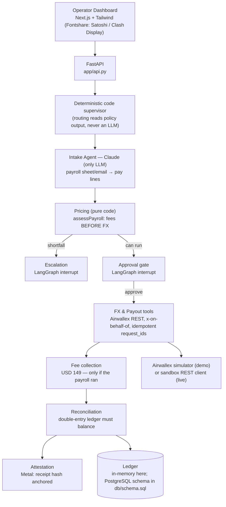

# PaySilo — Multi-Employer Payroll Executor

**Team STATIC · Airwallex Agentic Banking Hackathon · Starter Kit 06 (Multi-Tenant Platforms)**

> One platform. Many employers. Zero cross-contamination of funds.
> Payroll that respects whose money it is.

## The story

Vertex Payroll Services runs payroll for other small companies. Acme
Manufacturing GmbH loads USD 20,000 and must pay Lena Fischer EUR 3,400 and
Tomas Rivera EUR 2,600. Borealis Labs AB loads only USD 5,000 but owes
Ingrid Solberg EUR 6,000 — plus SWIFT fees, priced *before* conversion, the
USD 149 run fee, and a USD 1,000 reserve floor, it needs about USD 7,642.88.
Borealis is **short by USD 2,642.88**.

The platform total looks rich — and mid-run, Cobalt Retail LLC receives a
fresh USD 10,000 deposit. A tired accountant, or a badly built AI, quietly
covers Borealis from Acme or Cobalt. Nobody notices that day. Everybody
notices one day.

**PaySilo's golden rule is written in code, not in a prompt:** every
employer's money lives in its own sealed silo (its own Airwallex connected
account, wallet, and ledger namespace; every API call carries
`x-on-behalf-of`), and the agent can never move money between silos. When
Borealis comes up short, only Borealis's payroll is held and escalated to a
human. Cobalt's deposit changes Cobalt's wallet — not Borealis's.

> **The model reads, the code decides, the API moves the money.**
> The only LLM use in PaySilo is intake (reading messy payroll sheets) and
> plain-language explanation. Pricing, fees, affordability, tenant
> isolation, idempotency, and routing are deterministic, tested code.

## Architecture



Run lifecycle per employer:
`PRICED → RESERVED → APPROVED → SENT → SETTLED`, or `HELD_SHORTFALL`
(never borrowed, never silently dropped — escalated with the exact
shortfall and the employer's options).

## The LangGraph agent — architecture in depth

PaySilo's agent is a **LangGraph supervisor running one independent
subgraph per employer**. The supervisor itself is deterministic code —
it never asks a model where a run should go. Each employer's run gets
its own LangGraph thread (`thread_id` = the run id), its own state,
its own connected account and its own ledger namespace, so checkpoints,
interrupts and money are per-employer by construction. One employer's
failure is caught, recorded, and never contaminates the rest of the
batch.


### What each node does

| Node | Kind | Job |
|---|---|---|
| `intake` | **LLM** | Reads payroll sheets and emails into structured pay lines (Claude). Names are then matched against *this employer's own* contractor directory — a name that is not in the directory gets no bank details and cannot be paid. |
| `price` | code | Prices salaries plus payout fees per currency and method (SWIFT EUR 12.85 per payout) *before* any FX conversion. Unknown currency rate or fee schedule is a refusal, never a guess. |
| `assess` | code | Checks only this employer's wallet against payroll + the USD 149 run fee + the USD 1,000 reserve floor, and routes: approval, escalation, or refusal. |
| `approval` | human interrupt | Pauses the run. It resumes only with a Visa TAP signature over the exact run, employer, amounts and pay lines; a missing, tampered or replayed signature rejects the approval and moves no money. |
| `escalate` | human interrupt | Holds a short payroll and surfaces the exact shortfall and the employer's options. A short payroll can only be held — there is no "approve anyway" path. |
| `execute` | tools | Converts and pays on the employer's behalf only (`x-on-behalf-of`), each payout TAP-signed and verified immediately before the transfer, every call carrying a deterministic idempotent `request_id`. |
| `fee` | tools | Collects the USD 149 platform run fee — only from payrolls that actually ran. Held or refused runs are charged nothing. |
| `reconcile` | code | Proves the double-entry ledger matches the wallet in every currency and the books balance; a mismatch refuses to close the run. |
| `attest` | tools | Anchors a hash of the reconciliation receipt on the settlement chain (Metal). Hashes only — no raw financial data on chain. |

### Why only Intake uses an LLM

The model *reads*; the code *decides*; the API *moves the money*.
Reading messy human input (an email, a pasted sheet) is the one job
where a language model is genuinely better than rules — and its output
is the least trusted data in the system: extracted lines are matched
against the employer's own contractor directory, priced by
deterministic policy, checked for affordability, and still pause for a
signed human approval before a single unit moves. Everything
downstream of intake — fees, affordability, routing, tenant isolation,
idempotency — is arithmetic and policy, where "usually right" is not
acceptable and deterministic code is testable to the cent. An LLM
failure in intake is therefore bounded: at worst it produces a run a
human declines, never a payment.

Silo, the chat assistant, follows the same rule: its tools are scoped
to the signed-in organization (context comes from the session, never
from model input), and its tool set deliberately contains **no approve
tool and no transfer tool** — chat can start a run and surface its
pending approval, and that is all.

### The checkpointer story

A run paused at an interrupt must survive a restart, so graph state is
checkpointed per thread. `app/agents/checkpoint.py` picks the
checkpointer in order:

1. **File-backed SQLite** when `CHECKPOINT_PATH` is set — used by tests
   and single-node deployments; a new graph instance built on the same
   file resumes a paused run exactly where it stopped (proven by the
   restart tests in the suite).
2. **Postgres** (`PostgresSaver`) when `DATABASE_URL` points at
   Postgres — the production wiring (Supabase), through the same
   LangGraph checkpointer interface.
3. **MemorySaver** as a last-resort fallback — paused runs do *not*
   survive a restart in this mode, and the runtime says so honestly:
   such runs are reported as not resumable and a new run must be
   started.

Failed runs resume from their checkpoint too: progress markers
(`fx_done`, `completed_payouts`) plus deterministic `request_id`s mean
a retry skips work that already completed and can never pay a
contractor twice.

### Safety rules (enforced in code, tested in the suite)

- **Tenant isolation is absolute.** Organisation and employer context
  come from the authenticated session, never from model input; every
  query and every money call is scoped to one employer's silo.
- **Money moves only on a TAP-signed human approval.** The agent
  proposes, deterministic code decides, the API moves money. No tool —
  chat, intake, or otherwise — approves or transfers.
- **Allow-listed beneficiaries only.** A pay line must resolve to a
  contractor in the employer's own directory with bank details on file.
- **Every money-moving step is audited** in `agent_events`, and every
  Airwallex call is persisted with its `request_id`.
- **Limits are the affordability rule itself:** a run's priced total
  (payroll + payout fees + USD 149 run fee) plus the USD 1,000 reserve
  floor must fit inside the employer's own wallet, and because balances
  are ledger-derived, cumulative same-day runs draw down the same
  wallet and hit the same ceiling.

The behaviour above is pinned by the test suite: end-to-end money
tests, scenario tests (multi-currency, partial lists, mid-run deposits,
failure + retry, restart while paused) and an adversarial suite
(injection, cross-tenant requests, inflated amounts, replayed
approvals) — see `backend/tests/` and the intake eval in
`backend/evals/`.

## Partner tools — each with one concrete job

| Partner | Job in PaySilo | Where |
|---|---|---|
| **Airwallex** | The money itself: connected accounts, wallets, FX, beneficiaries, SWIFT transfers, platform charges — every employer-scoped call with `x-on-behalf-of` | `backend/app/airwallex/` |
| **Claude (Anthropic)** | The only LLM: intake (reads payroll sheets/emails into pay lines) + plain-language explanations. Never touches arithmetic or decisions | `backend/app/agents/intake.py` |
| **Visa TAP** | Signed payout instructions & approvals: Ed25519, RFC 9421-style signatures over method/authority/path + SHA-256 content digest, nonce replay guard, expiry — a captured approval can't pay twice or be redirected | `backend/app/partners/tap.py` |
| **Metal** | Reconciliation receipt anchoring: after a run settles, a hash of its receipt is anchored on a hash-linked settlement chain (offline mock here; Metal L2 stub fails closed until testnet env is set). Hashes only — no raw financial data | `backend/app/partners/metal.py` |
| **AWS Bedrock AgentCore** | Deployment runtime: the same graph wrapped as an AgentCore entrypoint, Gateway/observability mapping to the audit trail | `backend/app/partners/agentcore.py`, `deploy/agentcore/` |
| **LangGraph** | Agent orchestration with human-in-the-loop interrupts (approval + escalation) and checkpoint persistence | `backend/app/agents/graph.py` |


## Run it — demo mode, NO API keys

Needs Python 3.12 with [uv](https://docs.astral.sh/uv/) and Node 20+. The
commands below work in PowerShell and bash.

### Backend (Python 3.12 via uv)

```
cd backend
uv sync
uv run pytest
uv run uvicorn app.main:app --reload --port 8000
```

API docs at http://localhost:8000/docs.

Config is read from `.env` (repo root or `backend/`, see `.env.example`).
With no `DATABASE_URL` a local SQLite file `backend/paysilo.db` is used. For
Supabase, put the Postgres connection string in `DATABASE_URL` (special
characters in the password must be percent-encoded).

A demo organization is seeded automatically outside live mode: log in with
`demo@paysilo.test` / `SiloDemo2026`, or use the "Use demo account" button on
the login page.

Expected demo outcome (FX 1 EUR = 1.08 USD):

- **Acme** — required EUR 6,025.70 (6,000 + 2 × 12.85 SWIFT fees) → **SETTLED**, fee USD 149 charged.
- **Borealis** — needs ≈ USD 7,642.88 (SWIFT fees, USD 149 run fee, USD 1,000 reserve floor) vs USD 5,000 → **HELD_SHORTFALL** by USD 2,642.88, escalated; **no fee**.
- **Cobalt** — USD 10,000 deposit lands mid-run; Borealis re-check is unchanged; the cross-tenant guard refusal is written to the audit log.
- **Platform** — ends with exactly **USD 149** in fees. No tenant money touched.

Interactive runs: `POST /runs` (stops at the approval/escalation interrupt),
`POST /runs/{run_id}/approve` with `{"decision": "approve" | "hold"}`,
`GET /runs/{run_id}`.

### Frontend (Node 20+)

```
cd frontend
npm install
npm run dev
```

Open http://localhost:3000. The frontend calls `/api/*`, which Next.js proxies
to the backend at `BACKEND_URL` (default http://localhost:8000), so the session
cookie stays first-party. Regenerate the mascot animations with
`node scripts/lottie/build.mjs`.

### Docker (optional)

```
copy .env.example .env      # PowerShell / cmd (bash: cp .env.example .env)
```

Set `POSTGRES_PASSWORD` in `.env`, then:

```
docker compose up --build   # postgres + backend :8000 + frontend :3000
```

## Going live — where the keys go

Copy `.env.example` to `.env` and fill in:

- `AIRWALLEX_CLIENT_ID` / `AIRWALLEX_API_KEY` / `AIRWALLEX_BASE_URL` —
  Airwallex sandbox; set `APP_ENV=live` and the graph uses the REST client
  (`backend/app/airwallex/client.py`) instead of the simulator. Platform
  access + 3 connected accounts must be enabled by Airwallex for the team.
- `ANTHROPIC_API_KEY` — enables Claude intake for free-text payroll
  instructions. Without it, the deterministic fallback parser handles the
  structured demo input.
- `METAL_RPC_URL` / `METAL_PRIVATE_KEY` / `METAL_REGISTRY_ADDRESS` —
  faucet-funded Metal L2 testnet wallet + deployed `SettlementRegistry`.
  Until then `MetalL2SettlementChain` fails closed and demos use the mock
  chain (labelled `chain: "mock"` in every receipt — never faked).
- `DATABASE_URL` — PostgreSQL for persistence; apply `backend/db/schema.sql`.
  The LangGraph checkpointer swaps from `MemorySaver` to the Postgres
  checkpointer (`langgraph-checkpoint-postgres`) with no graph changes.

## Layout

```
backend/app/
  money.py            Decimal helpers, round-half-up 2dp
  policy.py           assessPayroll port (fee-first; unknown rate = refusal) + cross-tenant guard
  ledger.py           double-entry ledger: per-employer namespaces, zero-sum, cross-employer rejected
  airwallex/          client.py (real sandbox REST) · simulator.py (in-memory, idempotent)
  partners/           tap.py (Visa) · metal.py (Metal) · agentcore.py (AWS)
  agents/             state.py · intake.py (Claude) · graph.py (LangGraph) · demo.py (Kit 6 scenario)
  api.py · main.py    FastAPI surface
backend/db/schema.sql PostgreSQL DDL incl. tenant-isolation trigger
backend/tests/        pytest suite (all green, no keys needed)
frontend/             Next.js operator dashboard
deploy/agentcore/     AgentCore wrapping notes + sample config
```

## Honest limits of this build

- The ledger and run store are in-memory in this build; `db/schema.sql` is
  the persistence layer to wire next (the ledger rules are mirrored as a
  database trigger).
- The Airwallex REST client is complete code but unverified against the
  live sandbox (no keys during this build); the simulator is the verified
  path and implements the same interface.
- Metal L2 live submission is a fail-closed stub by design; mock receipts
  are always labelled as mock.
