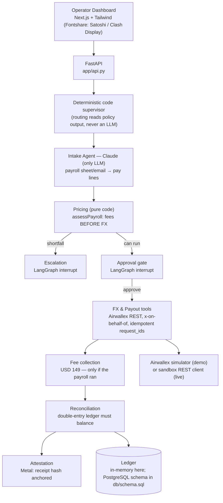

# PaySilo — Multi-Employer Payroll Executor

**Team STATIC · Airwallex Agentic Banking Hackathon · Starter Kit 06 (Multi-Tenant Platforms)**

> One platform. Many employers. Zero cross-contamination of funds.
> Payroll that respects whose money it is.

## The story

Vertex Payroll Services runs payroll for other small companies. Acme
Manufacturing GmbH loads USD 20,000 and must pay Lena Fischer EUR 3,400 and
Tomas Rivera EUR 2,600. Borealis Labs AB loads only USD 5,000 but owes
Ingrid Solberg EUR 6,000 — plus SWIFT fees, priced *before* conversion, the
USD 149 run fee, and a USD 1,000 reserve floor, it needs about USD 7,642.88.
Borealis is **short by USD 2,642.88**.

The platform total looks rich — and mid-run, Cobalt Retail LLC receives a
fresh USD 10,000 deposit. A tired accountant, or a badly built AI, quietly
covers Borealis from Acme or Cobalt. Nobody notices that day. Everybody
notices one day.

**PaySilo's golden rule is written in code, not in a prompt:** every
employer's money lives in its own sealed silo (its own Airwallex connected
account, wallet, and ledger namespace; every API call carries
`x-on-behalf-of`), and the agent can never move money between silos. When
Borealis comes up short, only Borealis's payroll is held and escalated to a
human. Cobalt's deposit changes Cobalt's wallet — not Borealis's.

> **The model reads, the code decides, the API moves the money.**
> The only LLM use in PaySilo is intake (reading messy payroll sheets) and
> plain-language explanation. Pricing, fees, affordability, tenant
> isolation, idempotency, and routing are deterministic, tested code.

## Architecture



Run lifecycle per employer:
`PRICED → RESERVED → APPROVED → SENT → SETTLED`, or `HELD_SHORTFALL`
(never borrowed, never silently dropped — escalated with the exact
shortfall and the employer's options).

## Partner tools — each with one concrete job

| Partner | Job in PaySilo | Where |
|---|---|---|
| **Airwallex** | The money itself: connected accounts, wallets, FX, beneficiaries, SWIFT transfers, platform charges — every employer-scoped call with `x-on-behalf-of` | `backend/app/airwallex/` |
| **Claude (Anthropic)** | The only LLM: intake (reads payroll sheets/emails into pay lines) + plain-language explanations. Never touches arithmetic or decisions | `backend/app/agents/intake.py` |
| **Visa TAP** | Signed payout instructions & approvals: Ed25519, RFC 9421-style signatures over method/authority/path + SHA-256 content digest, nonce replay guard, expiry — a captured approval can't pay twice or be redirected | `backend/app/partners/tap.py` |
| **Metal** | Reconciliation receipt anchoring: after a run settles, a hash of its receipt is anchored on a hash-linked settlement chain (offline mock here; Metal L2 stub fails closed until testnet env is set). Hashes only — no raw financial data | `backend/app/partners/metal.py` |
| **AWS Bedrock AgentCore** | Deployment runtime: the same graph wrapped as an AgentCore entrypoint, Gateway/observability mapping to the audit trail | `backend/app/partners/agentcore.py`, `deploy/agentcore/` |
| **LangGraph** | Agent orchestration with human-in-the-loop interrupts (approval + escalation) and checkpoint persistence | `backend/app/agents/graph.py` |


## Run it — demo mode, NO API keys

Needs Python 3.12 with [uv](https://docs.astral.sh/uv/) and Node 20+. The
commands below work in PowerShell and bash.

### Backend (Python 3.12 via uv)

```
cd backend
uv sync
uv run pytest
uv run uvicorn app.main:app --reload --port 8000
```

API docs at http://localhost:8000/docs.

Config is read from `.env` (repo root or `backend/`, see `.env.example`).
With no `DATABASE_URL` a local SQLite file `backend/paysilo.db` is used. For
Supabase, put the Postgres connection string in `DATABASE_URL` (special
characters in the password must be percent-encoded).

A demo organization is seeded automatically outside live mode: log in with
`demo@paysilo.test` / `SiloDemo2026`, or use the "Use demo account" button on
the login page.

Expected demo outcome (FX 1 EUR = 1.08 USD):

- **Acme** — required EUR 6,025.70 (6,000 + 2 × 12.85 SWIFT fees) → **SETTLED**, fee USD 149 charged.
- **Borealis** — needs ≈ USD 7,642.88 (SWIFT fees, USD 149 run fee, USD 1,000 reserve floor) vs USD 5,000 → **HELD_SHORTFALL** by USD 2,642.88, escalated; **no fee**.
- **Cobalt** — USD 10,000 deposit lands mid-run; Borealis re-check is unchanged; the cross-tenant guard refusal is written to the audit log.
- **Platform** — ends with exactly **USD 149** in fees. No tenant money touched.

Interactive runs: `POST /runs` (stops at the approval/escalation interrupt),
`POST /runs/{run_id}/approve` with `{"decision": "approve" | "hold"}`,
`GET /runs/{run_id}`.

### Frontend (Node 20+)

```
cd frontend
npm install
npm run dev
```

Open http://localhost:3000. The frontend calls `/api/*`, which Next.js proxies
to the backend at `BACKEND_URL` (default http://localhost:8000), so the session
cookie stays first-party. Regenerate the mascot animations with
`node scripts/lottie/build.mjs`.

### Docker (optional)

```
copy .env.example .env      # PowerShell / cmd (bash: cp .env.example .env)
```

Set `POSTGRES_PASSWORD` in `.env`, then:

```
docker compose up --build   # postgres + backend :8000 + frontend :3000
```

## Going live — where the keys go

Copy `.env.example` to `.env` and fill in:

- `AIRWALLEX_CLIENT_ID` / `AIRWALLEX_API_KEY` / `AIRWALLEX_BASE_URL` —
  Airwallex sandbox; set `APP_ENV=live` and the graph uses the REST client
  (`backend/app/airwallex/client.py`) instead of the simulator. Platform
  access + 3 connected accounts must be enabled by Airwallex for the team.
- `ANTHROPIC_API_KEY` — enables Claude intake for free-text payroll
  instructions. Without it, the deterministic fallback parser handles the
  structured demo input.
- `METAL_RPC_URL` / `METAL_PRIVATE_KEY` / `METAL_REGISTRY_ADDRESS` —
  faucet-funded Metal L2 testnet wallet + deployed `SettlementRegistry`.
  Until then `MetalL2SettlementChain` fails closed and demos use the mock
  chain (labelled `chain: "mock"` in every receipt — never faked).
- `DATABASE_URL` — PostgreSQL for persistence; apply `backend/db/schema.sql`.
  The LangGraph checkpointer swaps from `MemorySaver` to the Postgres
  checkpointer (`langgraph-checkpoint-postgres`) with no graph changes.

## Layout

```
backend/app/
  money.py            Decimal helpers, round-half-up 2dp
  policy.py           assessPayroll port (fee-first; unknown rate = refusal) + cross-tenant guard
  ledger.py           double-entry ledger: per-employer namespaces, zero-sum, cross-employer rejected
  airwallex/          client.py (real sandbox REST) · simulator.py (in-memory, idempotent)
  partners/           tap.py (Visa) · metal.py (Metal) · agentcore.py (AWS)
  agents/             state.py · intake.py (Claude) · graph.py (LangGraph) · demo.py (Kit 6 scenario)
  api.py · main.py    FastAPI surface
backend/db/schema.sql PostgreSQL DDL incl. tenant-isolation trigger
backend/tests/        pytest suite (all green, no keys needed)
frontend/             Next.js operator dashboard
deploy/agentcore/     AgentCore wrapping notes + sample config
```

## Honest limits of this build

- The ledger and run store are in-memory in this build; `db/schema.sql` is
  the persistence layer to wire next (the ledger rules are mirrored as a
  database trigger).
- The Airwallex REST client is complete code but unverified against the
  live sandbox (no keys during this build); the simulator is the verified
  path and implements the same interface.
- Metal L2 live submission is a fail-closed stub by design; mock receipts
  are always labelled as mock.
